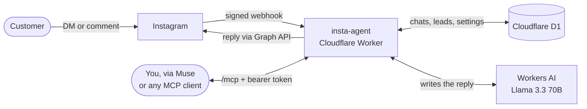
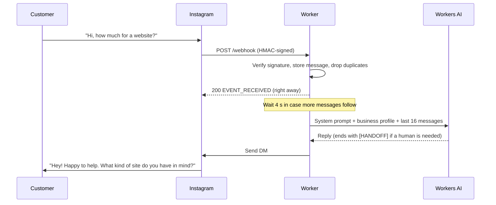

# muse-instagram

**A free, 24/7 AI assistant for your Instagram DMs, plus an MCP connector so Meta Muse (or any MCP client) can read your chats, reply, and track leads.**

[](https://workers.cloudflare.com/)
[](https://www.typescriptlang.org/)
[](https://modelcontextprotocol.io/)
[](https://developers.facebook.com/docs/instagram-platform)
[](#cost)

Someone DMs your business at 2 a.m. asking "how much for a website?" Within seconds they get a friendly reply that answers from *your* business info and asks about their project, budget and timeline. When they're ready to talk to a real person, the bot steps aside and flags the chat for you. Later you ask Muse *"Who messaged me on Instagram today?"* and get the full picture.

It runs on Cloudflare's free plan and uses Instagram's official API. There are no servers to manage and no monthly bill.

> Built for a web development agency. To use it for another kind of business, see [Customizing](#customizing).

---

## Contents

- [Features](#features)
- [How it works](#how-it-works)
- [Cost](#cost)
- [What Instagram allows (and doesn't)](#what-instagram-allows-and-doesnt)
- [Setup](#setup)
- [Configuration](#configuration)
- [MCP tools](#mcp-tools)
- [HTTP endpoints](#http-endpoints)
- [Local development and testing](#local-development-and-testing)
- [Project structure](#project-structure)
- [Customizing](#customizing)
- [Security](#security)
- [Troubleshooting](#troubleshooting)
- [Contributing](#contributing)

---

## Features

| | |
|---|---|
| ⚡ **Instant replies, 24/7** | Answers every new DM in seconds using Llama 3.3 70B on Workers AI. Replies are short and casual, in the customer's own language. |
| 🎯 **Lead qualification** | Collects the project type, key features, budget, timeline, and a name with a WhatsApp number or email. It asks one or two questions at a time and never repeats a question that's already been answered. |
| 🙋 **Smart handoff** | Flags the chat as `needs_human` when the customer asks for a person, is ready to start or pay, is upset, shares contact details, or asks something the bot can't answer. |
| 🤫 **Steps back when you jump in** | When you reply yourself from the Instagram app, the bot pauses for that chat (12 hours by default) so it doesn't talk over you. |
| 🧵 **Burst batching** | Waits 4 seconds after a message, so "hi" followed by "how much for a store?" gets one combined reply instead of two. |
| 💬 **Comment-to-DM** | When someone comments a keyword like "website" on your post, it sends them a private DM and can also post a public "Sent you a DM 📩" reply. |
| 🔌 **MCP connector** | Gives Muse, or any MCP client, 8 tools: list and read chats, reply, pause the bot, track leads, and edit what the bot knows. |
| 🛡️ **Safe by default** | Verifies Meta's webhook signature, drops duplicate deliveries, respects the 24-hour reply window, and never sends cold DMs. |
| 🔄 **Zero maintenance** | Refreshes the 60-day Instagram access token every week, so it never expires. |
| 🪂 **Graceful failure** | If the AI is unavailable or the free quota runs out, it sends one polite "the team will reply shortly" message and flags the chat for you. |
| 📄 **Ready for Meta's review** | Serves the privacy policy and data-deletion pages that Meta requires before an app can go Live. |

---

## How it works



**The life of a DM:**



**When the bot stays quiet:**

| Situation | What happens |
|---|---|
| You reply from the Instagram app | The bot pauses for that chat for `handoff_hours` (default 12) and clears `needs_human`. |
| You reply through Muse with `send_message` | Same pause, unless you pass `pause_bot: false`. |
| The bot handed the chat over | The chat is flagged `needs_human`. The bot keeps answering follow-up questions until you or Muse step in. |
| The bot is switched off | `set_bot_status` turns it off for everyone, or pauses a single chat for a set time or until you resume it. |
| The AI fails | The customer gets one holding message, the chat is flagged `needs_human`, and the bot doesn't repeat itself. |

Instagram echoes every message your account sends back to the webhook. Echoes of the bot's own messages are ignored. Any other echo means *you* typed in the Instagram app, and that's how the bot knows to step back.

---

## Cost

**$0 per month** for a typical small business.

| Service | Plan | Notes |
|---|---|---|
| Cloudflare Workers | Free | Hosts the bot and the MCP server. |
| Cloudflare D1 | Free | Stores chats, leads and settings. |
| Workers AI | Free (10,000 neurons/day) | Enough for roughly **150 to 300 replies a day**. Past that, the bot falls back to a holding message and flags the chat. |
| Instagram Graph API | Free | Meta's official messaging API. |

---

## What Instagram allows (and doesn't)

These limits are Instagram's rules, and no tool can get around them:

- **24-hour window.** Automated and API replies only work within 24 hours of the customer's last message. After that, reply from the Instagram app.
- **No cold DMs.** You can't message people who never wrote to you. Comment-to-DM is the one exception: it sends a single private reply to a comment, and the 24-hour window only opens once that person replies.
- **Live apps only.** Instagram only delivers webhooks to Meta apps that are switched to Live.

---

## Setup

Plan on about 30 to 60 minutes, most of it in Meta's developer dashboard.

### Prerequisites

- An Instagram **Professional** account (Business or Creator)
- A free [Cloudflare account](https://dash.cloudflare.com/sign-up)
- A free [Meta developer account](https://developers.facebook.com/)
- [Node.js](https://nodejs.org/) **22 or newer**

### 1. Prepare your Instagram account

1. Switch to a Professional account: **Settings → Account type and tools → Switch to professional account**.
2. Allow API access to your DMs: **Settings → Messages and story replies → Connected tools → Allow access to messages**.

### 2. Clone, install and create the database

```bash
git clone https://github.com/Rahulkumar070/muse-instagram.git
cd muse-instagram
npm install

npx wrangler login                  # opens the browser; a free account works
npx wrangler d1 create insta-agent  # prints a database_id
```

Open `wrangler.jsonc` and change these values to your own:

```jsonc
"d1_databases": [
  { "binding": "DB", "database_name": "insta-agent", "database_id": "<paste your database_id>" }
],
"vars": {
  "BUSINESS_NAME": "Your Agency",          // used in replies and on the privacy pages
  "CONTACT_EMAIL": "you@youragency.com",   // shown on the privacy and data-deletion pages
  ...
}
```

Then create the tables:

```bash
npm run db:init:remote
```

### 3. Deploy and set your own tokens

```bash
npm run deploy    # prints https://insta-agent.<your-subdomain>.workers.dev
```

Make two random strings, one for each token:

```bash
openssl rand -hex 32
```

```bash
npx wrangler secret put WEBHOOK_VERIFY_TOKEN   # paste the first random string
npx wrangler secret put MCP_TOKEN              # paste the second random string
```

Keep both strings somewhere safe. You'll need them in steps 4 and 6. Each `secret put` applies right away, so you don't need to redeploy.

Visit your worker URL. You should see **"Your Agency Instagram assistant is running."**

### 4. Create the Meta developer app

1. Go to [developers.facebook.com/apps](https://developers.facebook.com/apps) and create an app with the use case **"Manage messaging & content on Instagram"**.
2. Open **Instagram → API setup with Instagram business login** and do the following:
   - Copy the **Instagram app secret**, then run:
     ```bash
     npx wrangler secret put IG_APP_SECRET
     ```
   - Under **Generate access tokens**, add your Instagram account, generate a token, then run:
     ```bash
     npx wrangler secret put IG_ACCESS_TOKEN
     ```
     Turn on **webhook subscription** for the account on the same screen.
   - Under **Configure webhooks**, enter:
     - **Callback URL:** `https://insta-agent.<your-subdomain>.workers.dev/webhook`
     - **Verify token:** your `WEBHOOK_VERIFY_TOKEN`
     - Subscribe to **`messages`**, and also to **`comments`** if you want comment-to-DM.
3. In **App settings → Basic**, fill in:
   - **Privacy policy URL:** `https://insta-agent.<your-subdomain>.workers.dev/privacy`
   - **User data deletion URL:** `https://insta-agent.<your-subdomain>.workers.dev/data-deletion`
   - An **app icon** and a **category**
4. **Publish** the app by switching it to **Live**.
   - Meta may ask for **Business Verification**. It's free but needs business documents.
   - **Comment-to-DM** also needs *Advanced Access* for `instagram_business_manage_comments`, which goes through App Review.

You only do the access token once. It lasts 60 days, and the worker refreshes it every Monday at 03:00 UTC.

### 5. Tell the bot about your business

> [!IMPORTANT]
> Out of the box, the bot only knows a generic description of a web agency. Until you add your own prices, portfolio link and contact details, it will tell customers that it depends on scope.

The easiest way is through Muse (step 6):

> "Update my Instagram bot's business info: we build Shopify stores from 25k and landing pages from 8k, portfolio: https://…, WhatsApp: …"

Without Muse, call the MCP endpoint directly:

```bash
curl -X POST https://insta-agent.<your-subdomain>.workers.dev/mcp \
  -H "Authorization: Bearer <your MCP_TOKEN>" \
  -H "Content-Type: application/json" \
  -d '{
    "jsonrpc": "2.0", "id": 1, "method": "tools/call",
    "params": {
      "name": "update_settings",
      "arguments": {
        "business_profile": "Services: Shopify stores, landing pages, custom web apps.\nPricing: landing pages from $300, stores from $900.\nTimeline: 1 to 4 weeks.\nPortfolio: https://example.com/work\nContact: WhatsApp +1 555 0100, hello@example.com"
      }
    }
  }'
```

The bot treats `business_profile` as its only source of truth and never invents services, prices or links beyond it.

### 6. Connect Muse

Send this to Muse in a chat:

> Create a custom connector called "Instagram DMs". Its MCP server is `https://insta-agent.<your-subdomain>.workers.dev/mcp`, a public HTTPS endpoint that speaks streamable HTTP. It uses a bearer token in the Authorization header.

When Muse asks for the token, paste your `MCP_TOKEN`. Muse asks for your approval before it sends anything. The instant 24/7 replies come from the bot, not from Muse.

<details>
<summary><b>Using Claude Code or another MCP client instead</b></summary>

The `/mcp` endpoint is a standard, stateless MCP server (Streamable HTTP with JSON responses). It authenticates with `Authorization: Bearer <token>` or with an `x-api-key: <token>` header.

**Claude Code:**

```bash
claude mcp add --transport http instagram-dms \
  https://insta-agent.<your-subdomain>.workers.dev/mcp \
  --header "Authorization: Bearer <your MCP_TOKEN>"
```

**Quick check with curl:**

```bash
curl -X POST https://insta-agent.<your-subdomain>.workers.dev/mcp \
  -H "Authorization: Bearer <your MCP_TOKEN>" \
  -H "Content-Type: application/json" \
  -d '{"jsonrpc":"2.0","id":1,"method":"tools/list"}'
```

</details>

### 7. Try it

DM your business account **from a different Instagram account**. You should get a reply within about 5 to 10 seconds. To watch it happen live:

```bash
npx wrangler tail
```

Then ask Muse:

- *"Who messaged me on Instagram today? Is anyone waiting for me?"*
- *"Read the chat with @username and save them as a lead."*
- *"Show me all leads I've sent a proposal to."*
- *"Pause the bot for @username, I'll handle it."*
- *"Set the comment keywords to 'website, price'."*

---

## Configuration

### Variables (`wrangler.jsonc` → `vars`)

| Name | Value in this repo | Purpose |
|---|---|---|
| `BUSINESS_NAME` | `Exovio Agency` | Your business name, used in replies, the AI prompt and the privacy pages. |
| `CONTACT_EMAIL` | `hello.exovio@gmail.com` | Shown on `/privacy` and `/data-deletion`. |
| `AI_MODEL` | `@cf/meta/llama-3.3-70b-instruct-fp8-fast` | Any [Workers AI](https://developers.cloudflare.com/workers-ai/models/) chat model. |
| `IG_API_VERSION` | `v23.0` | Instagram Graph API version. |
| `DRY_RUN` | `false` | Set to `true` to log outgoing messages instead of sending them. |

### Secrets (`npx wrangler secret put <NAME>`)

| Name | Where it comes from |
|---|---|
| `IG_APP_SECRET` | Meta app → Instagram → API setup → **Instagram app secret**. Used to verify that webhooks really come from Meta. |
| `IG_ACCESS_TOKEN` | Meta app → Instagram → API setup → **Generate access tokens**. Replacing it takes effect immediately. |
| `WEBHOOK_VERIFY_TOKEN` | Any random string. Paste the same value into Meta's webhook settings. |
| `MCP_TOKEN` | Any long random string (`openssl rand -hex 32`). Muse uses it as the connector's bearer token. |

### Runtime settings (stored in D1, changed with `update_settings` or `set_bot_status`)

| Setting | Default | Purpose |
|---|---|---|
| `bot_enabled` | `true` | Master on/off switch for auto-replies and comment-to-DM. |
| `handoff_hours` | `12` | How long the bot stays quiet in a chat after you reply yourself (0 to 720). |
| `business_profile` | Generic web-agency text | Everything the bot knows: services, prices, portfolio, contact details, FAQs. |
| `comment_keywords` | *(empty, so comment-to-DM is off)* | Comma-separated trigger words, e.g. `website, price`. Matching ignores case and also matches inside longer words. |
| `comment_dm` | "Hey, thanks for the comment! …" | The private DM sent to someone who comments a keyword. |
| `comment_public_reply` | `Sent you a DM 📩` | The public reply under their comment. Set it to an empty string to turn it off. |

---

## MCP tools

| Tool | What it does | Main arguments |
|---|---|---|
| `list_conversations` | Lists recent chats, newest first, with each chat's bot status, `needs_human` flag, lead status and whether the 24-hour window is open. | `filter`: `all` \| `needs_human` \| `paused`, `limit` |
| `get_conversation` | Reads one chat with its saved lead details. | `igsid`, `limit` |
| `send_message` | Replies as the business and pauses the bot for that chat. Refuses if the 24-hour window has closed. | `igsid`, `text`, `pause_bot` |
| `set_bot_status` | Turns the bot on or off for everyone, or pauses or resumes one chat. | `active`, `igsid`, `hours` |
| `get_settings` | Shows the business profile, on/off state, handoff time and comment-to-DM settings. | none |
| `update_settings` | Changes the business profile, handoff time or comment-to-DM settings. | `business_profile`, `handoff_hours`, `comment_keywords`, `comment_dm`, `comment_public_reply` |
| `save_lead` | Creates or updates a lead. Only the fields you pass are changed. | `igsid`, `name`, `contact`, `project_type`, `budget`, `timeline`, `notes`, `status` |
| `list_leads` | Lists leads, most recently updated first. | `status`, `limit` |

Lead statuses go `new` → `contacted` → `proposal_sent` → `won` / `lost`.

The server supports MCP protocol versions `2025-11-25`, `2025-06-18`, `2025-03-26` and `2024-11-05`, as well as JSON-RPC batching.

---

## HTTP endpoints

| Method | Path | Purpose |
|---|---|---|
| `GET` | `/` | Health check |
| `GET` | `/webhook` | Meta's one-time webhook verification (`hub.challenge`) |
| `POST` | `/webhook` | Incoming DMs, echoes and comments. Requests must carry a valid `X-Hub-Signature-256`. |
| `POST` | `/mcp` | MCP server. Requires the bearer token. |
| `GET` | `/privacy` | Privacy policy page (required by Meta) |
| `GET` | `/data-deletion` | Data deletion instructions (required by Meta) |

A cron trigger (`0 3 * * 1`, Mondays at 03:00 UTC) refreshes the Instagram access token.

---

## Local development and testing

The test setup runs fully offline, with no Cloudflare login and no Instagram account. Outgoing messages are only logged (`DRY_RUN=true`), and the AI binding is left out, so replies use the fallback path.

```bash
npm run dev:test     # terminal 1: offline worker on http://localhost:8787
npm run test:local   # terminal 2: 31 end-to-end checks
npm run typecheck    # TypeScript strict mode
```

The suite covers webhook verification and signatures, duplicate deliveries, burst batching, echo handling, owner-reply pausing, every MCP tool, comment-to-DM, the 24-hour window, and the global on/off switch.

<details>
<summary><b>Running against the real AI locally</b></summary>

`npm run dev` uses your real `wrangler.jsonc`, which means a local D1 database, the real Workers AI (this needs `wrangler login`), and **real Instagram sends** unless you set `DRY_RUN` to `"true"`.

```bash
npm run db:init:local
```

Create a `.dev.vars` file (it's gitignored):

```ini
IG_APP_SECRET=local-test-secret
IG_ACCESS_TOKEN=local-test-token
WEBHOOK_VERIFY_TOKEN=local-verify-token
MCP_TOKEN=local-mcp-token
```

```bash
npm run dev
```

</details>

---

## Project structure

```
├── src/
│   ├── index.ts        # Router (/webhook, /mcp, /privacy, /data-deletion) and the weekly cron
│   ├── webhook.ts      # Signature check, DM/echo/comment handling, 4 s debounce
│   ├── bot.ts          # System prompt, AI reply, handoff logic, send-and-record
│   ├── instagram.ts    # Instagram Graph API client, token refresh, dry-run mode
│   ├── mcp.ts          # Stateless MCP server and its 8 tools
│   ├── db.ts           # D1 queries, default settings and business profile
│   ├── pages.ts        # Privacy policy and data deletion pages
│   └── types.ts        # Env bindings and shared types
├── scripts/
│   ├── test-local.mjs        # End-to-end test suite
│   └── wrangler.test.jsonc   # Offline config (dry run, no AI)
├── schema.sql          # D1 tables
├── wrangler.jsonc      # Worker config: D1, AI, cron, vars
└── package.json
```

**Database tables** (`schema.sql`):

| Table | Holds |
|---|---|
| `conversations` | One row per customer: username, last message, 24-hour window start, pause time, `needs_human` |
| `messages` | Full chat history, tagged by sender (`user`, `bot`, `owner` or `muse`). Instagram's message ID is unique, which is how duplicates are dropped. |
| `leads` | Potential clients and their pipeline status |
| `comment_replies` | Comments that already got a DM, so nobody gets two |
| `settings` | Runtime settings and the auto-refreshed access token |

---

## Customizing

| To change... | Edit |
|---|---|
| What the bot knows | `business_profile`, through Muse or `update_settings`. No redeploy needed. |
| Tone, length, or when to hand off | `systemPrompt()` in [`src/bot.ts`](src/bot.ts) |
| The AI model | `AI_MODEL` in [`wrangler.jsonc`](wrangler.jsonc) |
| The kind of business (not a web agency) | The words "a web development agency" in [`src/bot.ts`](src/bot.ts), `DEFAULT_PROFILE` in [`src/db.ts`](src/db.ts), and the wording in [`src/pages.ts`](src/pages.ts) |
| The wait before replying | `DEBOUNCE_MS` in [`src/webhook.ts`](src/webhook.ts) (default 4000 ms) |
| How much history the AI sees | `HISTORY_LIMIT` in [`src/bot.ts`](src/bot.ts) (default 16 messages) |
| The holding message used when the AI fails | `fallbackText()` in [`src/bot.ts`](src/bot.ts) |

Run `npm run deploy` after any code change.

---

## Security

- **Webhooks are authenticated.** Every `POST /webhook` is checked against an HMAC-SHA256 signature made with your app secret. Unsigned or forged requests get a `401`.
- **The MCP server is private.** Every request needs your `MCP_TOKEN`. Tokens are compared in constant time.
- **No secrets in code.** Secrets live in Cloudflare (`wrangler secret`). `.dev.vars` and `.secrets.local` are gitignored.
- **To rotate a token,** run `npx wrangler secret put MCP_TOKEN` and update the token in Muse. A new `IG_ACCESS_TOKEN` takes effect immediately and overrides the auto-refreshed copy.
- **To protect customers,** the bot is told never to commit to prices, deadlines, discounts or contracts, and to answer only from your business profile.

---

## Troubleshooting

| Problem | Likely cause and fix |
|---|---|
| Meta says **"The callback URL or verify token couldn't be validated"** | `WEBHOOK_VERIFY_TOKEN` doesn't match what you typed in Meta, or the URL is missing `/webhook`. |
| **No replies at all** | The app isn't **Live**; webhook subscription isn't turned on for your account; **Allow access to messages** is off in Instagram; or you're DMing from the business account itself. Run `npx wrangler tail` to see whether webhooks arrive. |
| Logs show **`Invalid signature` (401)** | `IG_APP_SECRET` is wrong. Use the **Instagram** app secret from the Instagram API setup page, not the Facebook app secret. |
| The bot always says **"Someone from the team will reply here shortly"** | The AI call failed: the daily free Workers AI quota is used up, or `AI_MODEL` is invalid. Check `npx wrangler tail`. |
| The bot **ignores one person** | That chat is paused because you replied from the Instagram app or through Muse. Ask Muse to resume it, or call `set_bot_status` with `active: true` and the chat's `igsid`. |
| `send_message` fails with a **"24 hours"** error | This is Instagram's rule. Reply from the Instagram app instead. |
| **Comment-to-DM** does nothing | `comment_keywords` is empty by default. You also need the `comments` webhook subscription and Advanced Access for `instagram_business_manage_comments`. |
| Instagram API errors **after about 60 days** | The weekly token refresh failed. Generate a new token and run `npx wrangler secret put IG_ACCESS_TOKEN`. |

---

## Contributing

Issues and pull requests are welcome. Before opening a PR:

```bash
npm run typecheck
npm run dev:test    # in one terminal
npm run test:local  # in another; all 31 checks should pass
```
